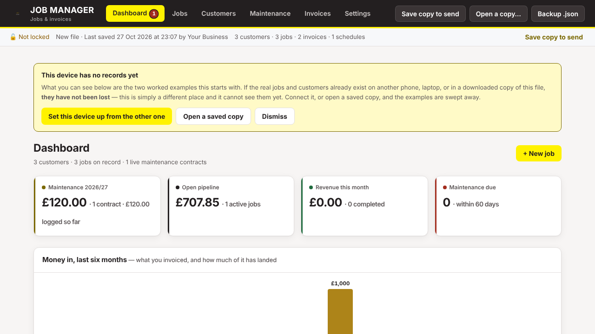

# Small trade job manager

A job, quote and invoice manager for a small trade business, in one HTML file. It runs in the browser on a phone or a laptop, works with no signal, and keeps the records encrypted on your own devices.

I built it for a family electrical and security firm. This repository is a separate copy made for publishing. It contains no records from that business and has no connection to its copy, its address or its sync service.



## What it does

- **Customers and jobs.** Each job has a type, a status (enquiry, quoted, scheduled, in progress, completed, invoiced), a site, dates and a scope of works.
- **Quote tracking.** Quotes are marked awaiting, accepted or declined, and outstanding quotes show on the dashboard.
- **Pricing.** You enter the cost of the equipment, and the sell price applies your margin. Labour is charged as hours times rate. Extra costs the customer is not itemised for come off your profit and never appear on the invoice.
- **Invoices.** An itemised invoice raised from a job stays linked to it, so editing the job rewrites the invoice. There is also a letter-style invoice priced by hand. Both print to A4 or save as PDF.
- **Maintenance contracts.** These have visit dates and reminders.
- **Purchases.** A record of where the kit came from, for warranties and returns.
- **Photos.** Up to 8 per job, shrunk before saving. They are internal only and never printed on an invoice.
- **Getting data out.** Backups, CSV exports, and a "save copy to send" that hands the whole file to another device.

## Where your data lives

- **On your device.** The records are kept in the browser storage of each phone or laptop you use. The app's files hold no records. Anyone who opens the app at its address gets an empty app (with sample data) and, once you set a passphrase, a lock screen.
- **Encrypted.** With a passphrase set, the records are encrypted with AES-GCM (256-bit key, derived with PBKDF2-SHA256 at 250,000 rounds) before they are saved.
- **Sync is optional.** If you turn it on, the records are encrypted on the device before they leave it. The sync service (`sync-worker/sync-worker.js`, which you deploy on your own Cloudflare account) stores only that encrypted blob, keyed by a hash of your sync code. It cannot read it, and a different sync code reaches nothing.
- **Your own copy.** Your sync address, sync code and passphrase are typed in on each device and stored only there. None of them is in this repository.

## Running it

1. **Hosting it (needed on iPhone).** Upload the `app/` folder to any static host. With Cloudflare Pages: Workers & Pages, then Create, then Pages, then Upload assets. Open the address, then on iPhone use Share, then Add to Home Screen. iOS deletes a website's saved data after seven days without a visit unless the app is on the Home Screen.
2. **On a laptop only.** You can also open `app/index.html` straight from disk.
3. **If you want only yourselves to reach the address.** Put it behind Cloudflare Access (Zero Trust, free tier) and allow only your own email addresses.
4. **Sync.** The steps are in the app under Settings, then Sync. Briefly: create a KV namespace called `JOBMGR`, create a Worker from `sync-worker/sync-worker.js`, bind the namespace to it as `JOBMGR`, and paste the Worker's address into the app. You can set `ALLOWED_ORIGIN` on the Worker to your app's address.

## Tests

```
node tests/sync_test.mjs   # two browsers sync through the Worker; the server holds only ciphertext
python3 tests/scan.py      # fails if anything like a phone number, email, postcode, key or backup file is committed
```

`sync_test.mjs` needs Node 18 or later and Playwright (`npm i playwright`).

## Where it stops

- It is not accounting software. It does no VAT returns, bank feeds or Making Tax Digital submissions.
- It is meant for one business on a few devices, not a team with user permissions.
- Cloudflare KV can take up to a minute to show a write everywhere, so two devices editing at the same moment may need a second sync. The app retries and merges.
- If you forget the passphrase, the records cannot be recovered. Keep a backup.
- The security has not been independently audited.

## How it was made

This was built with AI assistance (Claude, by Anthropic). I specified it, tested it and reviewed the code before publishing.

## Licence

MIT. See [LICENSE](LICENSE). The bundled jsPDF library keeps its own MIT licence notices.
